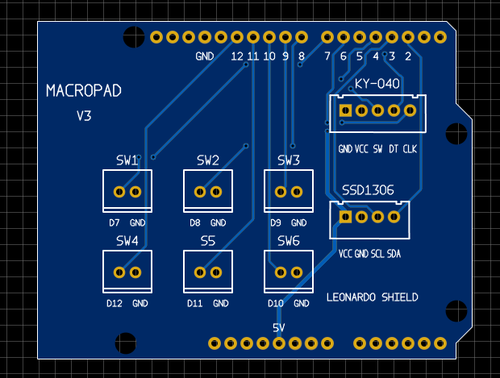
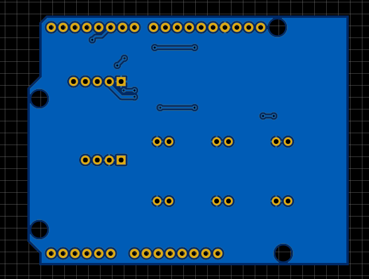

# MacroPad V3

**An open-source Arduino Leonardo shield featuring six programmable buttons, a rotary encoder, and an OLED display.**

MacroPad V3 is a custom PCB shield designed for the Arduino Leonardo. It combines multiple input methods in a modular design, allowing users to build a customizable macro controller.

The hardware was designed using **EasyEDA**. Schematic files, PCB design exports, manufacturing files, and documentation are available in this repository.

> [!WARNING]
> **Untested Hardware**
>
> This PCB has not yet been physically manufactured or tested. Electrical functionality and mechanical compatibility have not been verified on physical hardware.
>
> Please review the design carefully before manufacturing.

## Features

- **6 Programmable Buttons:** Support for six external mushroom-style push buttons.
- **Rotary Encoder:** KY-040 rotary encoder with an integrated push button.
- **OLED Display:** 0.96-inch, 128×64 SSD1306 display with I²C communication.
- **Arduino Leonardo Compatibility:** Designed as a shield for the Arduino Leonardo.
- **Modular Connections:** JST-XH connectors for external components.
- **Open Hardware:** Design files are available for modification and redistribution.

## PCB Preview

### Front Side

### Back Side

## Hardware

| Component | Quantity | Description |
|---|---|---|
| Arduino Leonardo | 1 | Main microcontroller board |
| Mushroom Push Button | 6 | External programmable buttons |
| KY-040 Rotary Encoder | 1 | Rotary encoder with push button |
| SSD1306 OLED Display | 1 | 0.96", 128×64, I²C |
| 2-Pin JST-XH Connector | 6 | Button connections |
| 5-Pin JST-XH Connector | 1 | Rotary encoder connection |
| 4-Pin JST-XH Connector | 1 | OLED display connection |
| Arduino Shield Headers | 1 set | Connection to Arduino Leonardo |

For the complete component list, see [`production/bom.csv`](production/bom.csv).

## Hardware Design Files

The `Hardware/` directory contains the schematic and PCB design exports.

- `schematic.json`: EasyEDA schematic source